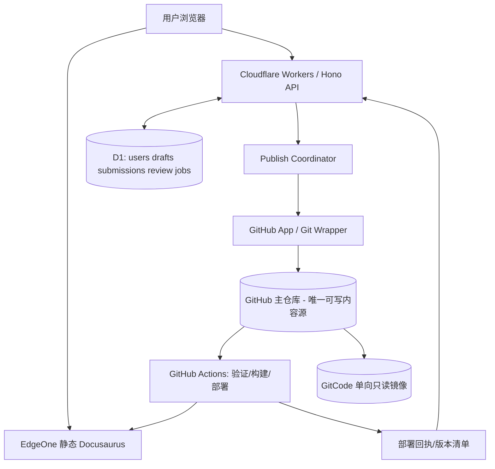

# RocoWiki V1 — 社区共建 Wiki 架构设计文档

> 状态：设计基线 / 已建立本地首版架构，外部 PoC 待验证  
> 日期：2026-10-10  
> 面向：洛克王国页游 Wiki；用户自主注册、站内编辑与审核、可选 GitHub 贡献关联、静态发布。  
> 本文描述设计基线；已建立本地架构实现与测试，**不代表已经完成真实部署或外部平台 PoC 验证**。

## 1. 设计目标与非目标

### 目标
1. 阅读无需登录；普通用户无需 Git 账号、Git 命令、Fork/PR 知识即可投稿。
2. Wiki 自有 UID 为唯一业务身份；GitHub 可选绑定，只用于公开个人主页和经授权的 `Co-authored-by` 关联。
3. 已发布内容与历史以 **GitHub 主仓库**为权威；**GitCode 仅单向只读镜像**；合并一律 **Merge Commit，禁止 Squash/Rebase Merge**。
4. 用户、身份绑定、草稿、审核和任务状态由 **Cloudflare D1** 管理；Workers/Hono 承担 API。
5. Docusaurus 静态生成 Wiki；EdgeOne Makers 全球可用区（不含中国大陆）托管 `.app` 自定义域名。其是否满足大陆访问性能须实测。
6. 最小权限、审核后发布、可重试、可回溯、可恢复；允许未来替换 GitCode、托管和数据库。

### V1 非目标
实时多人共同编辑、论坛/评论、积分排行榜、大规模图谱查询、自动 AI 审核、复杂用户角色体系、可执行 MDX 的社区编辑权限。

## 2. 高层拓扑与权威数据



| 信息/状态 | 权威来源 | 备注 |
|---|---|---|
| 已发布 Wiki Markdown/结构化数据及历史 | GitHub 默认分支 | 正式版本以不可变 commit SHA 标识 |
| 用户 UID、登录态、GitHub 绑定 | D1 | GitHub login 可变；必须保存数字 GitHub ID |
| 草稿、投稿、审核记录 | D1 | 不向公开 Git 历史泄露私有草稿 |
| Co-author 归属 | D1 授权快照 + Git Commit Trailer | Commit 必须记录 Wiki Revision ID |
| 网站当前线上版本 | EdgeOne 部署记录/版本文件 | 需验证实际服务的 commit SHA |
| 国内源码镜像状态 | GitCode 对 GitHub SHA 的追赶情况 | 镜像失败不能标记主发布失败 |

## 3. 模块边界

### 3.1 `apps/web` — Docusaurus
- 静态页面、图鉴、技能列表、研究文章、搜索、用户主页前端、登录与编辑入口。
- 可信 React/MDX 组件由开发者提交；公众只能编辑受限 Markdown 或业务表单，禁止提交任意 JSX、import、HTML 脚本。
- 前端不含 GitHub App 私钥、D1 凭据、部署令牌；API 统一调用 Worker。
- 页面应展示版本、来源等级、修订历史和投稿状态；公开页面即使 API 故障也可阅读。

### 3.2 `apps/api` — Workers/Hono
- 注册、登录、会话、OAuth 绑定、投稿、权限/风控/限速、审核入口、公开用户资料 API。
- **所有 UID、角色和 Co-author 邮箱由服务端推导**，绝不信任前端声明。
- Session 建议 HttpOnly+Secure+SameSite Cookie；同源/BFF 反代或严格配置跨域白名单；状态变更需 CSRF 防护、Origin/Referer 检查。
- V1 已确认采用成熟 OIDC 身份服务，由提供商完成注册与邮箱核验；仅接受已验证邮箱，Wiki 自有 UID 不变，GitHub 绑定独立可选。将来引入密码模式时必须采用成熟认证库、强哈希、密码重置和验证流程。

### 3.3 `packages/wiki-schema` 与 `content-validator`
- 对文章、宠物、技能建立明确 JSON Schema / Zod 校验；页面 ID 固定映射路径，禁止由用户传完整文件路径。
- HTML/Markdown 安全：使用受限 Markdown 解析器和允许列表，对链接协议、图片 URL、HTML、大小与数量进行服务端约束；不得把任意用户文本作为 JS/MDX 执行。
- 富文本编辑器输出中间数据或纯 Markdown，可信渲染器转换至最终内容；预览也必须安全解析，不能使用不可信 MDX 编译器。
- 同步校验数据引用（宠物 ID、技能 ID、版本和来源）；检查内容长度、特殊字符与文件扩展名。

### 3.4 `packages/publish-coordinator`
- 实现投稿审核后发布的**持久化状态机**、队列/轮询、冲突检测、幂等及故障恢复。
- 原则：D1 与 GitHub、EdgeOne 间无分布式事务，采用幂等补偿式 Saga；D1 Outbox 同事务写入任务，后台 Worker 执行外部副作用。
- 事件与消息可重复、乱序、丢失；以 D1 持久记录和定期 reconcile 为最终收敛来源。

### 3.5 `packages/git-wrapper`
- 用 GitHub App installation token 操作受限仓库：读取目标 blob、分支、独立 Commit、PR、merge 状态查询；不得对任意仓库和路径开放写入 API。
- App 安装仅授权专用仓库及最少权限；App 密钥放 Secret，安装令牌短期获取；发布机器人和 CI 凭据隔离。
- 默认分支保护：必要 CI 检查、审核策略、禁止 force push / 删除、禁止绕过；不要依赖“Bot 有权限所以安全”。
- 单投稿对应单独内容 Commit；如一个 PR 含多投稿也不压缩 Commit；普通 Merge Commit 保留原始内容 Commit。若一个投稿包含多文件，仍尽量是一个原子 Commit。

### 3.6 GitCode Mirror
- 只从 GitHub 默认分支 Pull；不向主仓库回推、不做双向自动镜像。
- 定期对比镜像 HEAD SHA 与主仓库；展示 `synced / lagging / failed`；可人工重同步。
- 不假设 PR、Issue、评论或仓库权限能随 Git 对象自动镜像。

### 3.7 CI/CD + EdgeOne
- 合并到 GitHub 受保护默认分支后触发 CI；先静态校验、依赖锁定与构建，再发布静态文件。
- **隔离信任级别**：来自公开投稿的 PR 仅运行无密钥、最小权限的校验；禁止用 `pull_request_target` 检出并执行外部投稿代码。部署密钥只在受保护分支可信作业中可用。
- 推荐由可信工作流先构建、测试并生成 artifact，再用专门的发布作业推送 EdgeOne；维护不可变 `release_id / source_commit_sha / artifact_digest`。
- 网站部署后通过公开的 `/version.json` 或部署 API 核验 `source_commit_sha`，然后确认 `published`；不要仅凭 HTTP 200 或“CI job succeeded”判定上线。
- `.app` 未备案：EdgeOne Makers 使用**全球可用区（不含中国大陆）**并绑定自定义域名；大陆真实访问效果需跨运营商实测。

## 4. 身份与 Co-author 归属

**内部 UID 永远是主键**，GitHub 是可选外部身份。

1. 已登录 Wiki 用户点「绑定 GitHub」，服务端创建一次性 `state`，关联当前 UID，绑定短时过期并防重放。
2. 跳转 GitHub OAuth / GitHub App 用户授权；服务端验证回调、读取 GitHub 数字 ID 与账户信息。
3. 需邮箱读取权限时才申请相应最小用户级权限；仅选择 GitHub 账号**已验证且用户同意公开的 Commit 邮箱**，优先使用已确认的 noreply 地址。无法确定可关联邮箱则不添加 Co-author。
4. 同一个 GitHub 数字 ID 只能绑定一个 Wiki UID；换绑或解绑需要重新认证；记录授权版本和时间。
5. 用户每次提交时保存 `coauthor_opt_in` 的不可变快照，审核发布时按该次授权及绑定状态再校验；不将邮箱接受字段交由客户端任意填入。
6. 原有 Git 提交中公开的邮箱无法保证撤回，绑定时告知不可逆风险；解绑后不再为未来提交标记。
7. 可用 `Co-authored-by: Display Name <verified-address>`；`Wiki-User-ID`、`Wiki-Revision-ID` 放 Commit Trailer；公开 Wiki UID 用不可猜敏感属性的公共 ID。

**示例 Commit（占位身份，不得直接用于真实用户）**：

```text
wiki: update critical-hit article

Wiki-Revision-ID: rev_abcdef
Wiki-User-ID: usr_public123
Co-authored-by: ExampleUser <verified-noreply@example.invalid>
```

> `Co-authored-by` 是 **Commit 层**，不是 PR 层。GitHub 是否在个人贡献图计数还受仓库、分支和身份条件限制。仅保存实际被采纳的投稿贡献；站内积分独立于 GitHub 贡献图。

## 5. 编辑与审核协议

### 5.1 数据输入
- Article：`page_id, base_commit_sha, base_blob_sha, content_markdown, edit_summary, source_references`。
- Structured：`entity_type, entity_id, base_data_revision, patch, edit_summary`。
- API 服务端检查：本人会话、投稿频率、允许的对象、内容 Schema 和具体字段 ACL。

### 5.2 草稿与审核
- D1 保存 draft 和 submission；提交后锁定一份候选快照，后续补充创建新候选版本而不是原地改写已审核快照。
- 审核员界面展示基线差异、来源、相关历史；审批动作带审核人 UID 和时间戳。
- 审核与本人投稿的权限隔离；默认不得自审；至少关键机制和可执行组件需二次审查或开发者处理。

### 5.3 并发解决
- 每次编辑附 `base_blob_sha`；发布前比对 GitHub HEAD 文件内容；相同则直接提交。
- V1 已确认：基线不同时进入 `conflict` 人工复核，整理新候选后重新审核；**不在审核后自动三方合并**，避免实际写入内容与审核快照不同。结构化数据使用受限字段补丁，同样检查基线。
- **绝不采用 last-write-wins 覆盖已有提交**；合并后保留来源投稿 ID 与原始审查上下文。

## 6. 发布状态机

| 状态 | 条件 | 可执行转移 |
|---|---|---|
| `draft` | 用户草稿 | `pending_review` |
| `pending_review` | 待审核 | `changes_requested`, `rejected`, `approved` |
| `changes_requested` | 要求补充 | `pending_review`（新候选） |
| `rejected` | 审核驳回 | 终止；允许新投稿 |
| `approved` | 已批准快照，写入 Outbox | `git_pending` |
| `git_pending` | Bot 生成分支、Commit、PR | `git_pr_open`, `retryable_error` |
| `git_pr_open` | PR 开启，CI 检查中 | `git_merged`, `conflict`, `retryable_error` |
| `git_merged` | 主分支已包含内容 Commit | `deploying` |
| `deploying` | 发布作业执行中 | `published`, `retryable_error` |
| `published` | 当前线上版本含目标 commit | 终态（站点后续回滚另记事件） |
| `conflict` | 版本差异不可自动合并 | 重新审核/人工合并 |
| `retryable_error` | 外部操作失败、保留阶段信息 | 原阶段幂等重试 |

**注意：** 主站部署了更晚的主分支 commit 时，不应要求线上 HEAD 与投稿 merge SHA 完全相等；应证明**线上部署的 commit 可达且包含对应内容 commit**，并且线上版本没有回滚覆盖它。若无法可靠证明包含关系，则按部署批次记录并在同一批次中确认各投稿。

- `idempotency_key`：对外投稿操作请求去重；发布任务用 `revision_id + operation` 唯一约束。
- `webhook_events`：GitHub delivery ID 去重、HMAC 验签、异步入队；处理顺序与数据库版本校验相结合。
- `reconcile`：周期扫描超时任务，主动核验 GitHub PR、merge SHA、EdgeOne release 及 GitCode mirror。
- 回滚：先在 GitHub 创建 revert 内容提交，再发布新静态版本；保留 D1 原始投稿记录并产生撤回事件，不能将旧记录擦除。

## 7. 数据库草案（D1）

> 以下为逻辑表，不是直接可执行的生产迁移。迁移时补全索引、唯一约束、CHECK、外键策略、租约字段、JSON 验证和保留策略。

| 表 | 关键字段 | 约束 |
|---|---|---|
| `users` | `uid, username, display_name, role, created_at` | UID 不可变；用户名唯一；V1 不存密码 |
| `oidc_identities` | `issuer, subject, uid` | issuer + subject 唯一；不按邮箱合并账号 |
| `sessions` | `id_hash, uid, expires_at, revoked_at` | 会话令牌只存哈希 |
| `github_identities` | `uid, github_numeric_id, login, coauthor_email, enabled, consent_at` | github_numeric_id 唯一 |
| `pages` | `page_id, content_path, content_type` | 路径只能由服务端受控生成 |
| `drafts` | `draft_id, uid, page_id, base_blob_sha, body, updated_at` | 草稿隐私权限 |
| `submissions` | `revision_id, uid, page_id, snapshot_hash, status, edit_summary, created_at` | 状态受控转移 |
| `submission_content` | `revision_id, content, base_commit_sha, base_blob_sha, sources_json` | 不可变审核快照 |
| `reviews` | `review_id, revision_id, reviewer_uid, verdict, comment, created_at` | 不能自审 |
| `publish_jobs` | `job_id, revision_id, stage, idempotency_key, lease_until, retries, last_error` | 唯一幂等键 |
| `git_links` | `revision_id, branch, pr_number, content_commit_sha, merge_sha` | 不能把 PR 编号当唯一身份 |
| `deployments` | `release_id, source_sha, artifact_digest, environment, status, deployed_at` | 只接受可信构建回执 |
| `webhook_events` | `delivery_id, event_type, received_at, processed_at` | 去重 |
| `audit_events` | `actor_uid, action, target_id, ts, metadata` | 管理员事件不可静默覆盖 |

数据备份：D1 导出到独立安全存储并加密；定期恢复演练；私有用户数据不输出到公开 Git 仓库；定义数据保留、用户注销与导出机制。D1 Time Travel 不等于独立永久备份。

## 8. 核心 API 草案

| Method | Path | 授权 | 功能 |
|---|---|---|---|
| POST | `/auth/register` | 匿名+风控 | 注册 |
| POST | `/auth/login` | 匿名+风控 | 登录 |
| POST | `/auth/logout` | 登录 | 注销会话 |
| POST | `/auth/github/start` | 登录+CSRF+近期重认证 | 绑定发起 |
| GET | `/auth/github/callback` | OAuth 回调 | 核验并绑定 |
| DELETE | `/me/github` | 登录+近期重认证 | 解绑 |
| GET | `/pages/:pageId/edit-base` | 登录 | 获取可编辑基线 |
| PUT | `/drafts/:draftId` | 草稿作者 | 保存草稿 |
| POST | `/submissions` | 登录+CSRF | 提交审核 |
| GET | `/submissions/:id` | 作者/审核员 | 查看状态 |
| POST | `/reviews/:id/decision` | 审核员 | 审核决定 |
| GET | `/users/:publicUid` | 公开 | 脱敏用户资料与贡献 |
| POST | `/webhooks/github` | HMAC 验签 | GitHub 回执 |
| POST | `/webhooks/deploy` | 可信签名 | 部署回执 |

API 应使用明确错误码（`CONFLICT`, `STALE_BASE`, `RATE_LIMITED`, `UNAUTHORIZED`, `INVALID_CONTENT`, `UPSTREAM_RETRYING`），不能将私有信息写入响应或日志。

## 9. 威胁模型与措施

| 风险 | 影响 | V1 必备措施 | 验收方法 |
|---|---|---|---|
| Wrapper 任意路径写入 | 仓库代码被修改 | 固定目录、路径映射、类型白名单、App 最小权限、主分支保护 | 尝试 `../`、编码绕过、特殊路径并断言拒绝 |
| 社区 MDX/HTML 注入 | CI 任意代码执行、XSS | 普通用户只编辑安全 Markdown/结构化数据；可信代码生成 MDX；无密钥 PR 构建 | 构造 JSX/import/HTML/script/恶意 URL 测试 |
| 用户账户劫持 | 恶意投稿、冒名 Co-author | 安全会话、CSRF、登录限速、邮箱核验、OAuth state/PKCE（适用时） | 重放回调、跨站提交、Session fixation 测试 |
| GitHub 绑定抢占 | Github 身份错误归属 | 数字 ID 唯一、回调与当前会话关联、重绑定验证 | 同 GitHub ID 尝试绑定两个 UID |
| 无授权邮箱公开 | 永久隐私泄漏 | 明确 opt-in、验证来源、优先 noreply、写入快照 | 关闭授权后不得新增 Trailer |
| 并发编辑覆盖 | 数据丢失 | base sha、冲突复核、新候选重新审核 | 同页双人并发修改 |
| Webhook 重复/乱序/丢失 | 重复 PR 或状态错误 | 验签、事件去重、D1 Outbox、定期 reconcile | 人为重放、丢弃、乱序事件 |
| D1 与 Git/部署不一致 | 虚假发布成功 | 状态机、commit 与 release 可追溯、幂等、补偿 | 断网、超时、CI 失败、部署回滚 |
| CI 凭据泄漏 | 供应链攻击 | PR 无密钥检查、受保护主分支发布、锁定依赖权限 | 恶意 PR 无法读取 secret |
| 滥用、刷投稿 | DB 额度/审核资源耗尽 | IP+UID 限速、验证码按风险启用、草稿/提交配额 | 压力及滥用测试 |
| 缓存陈旧 | 网站显示旧版 | HTML 短缓存、哈希资源长期缓存、发布后版本验证 | 部署回滚、跨节点验证 |
| 外部平台故障 | 投稿卡住 | 重试退避、任务可恢复、手工操作工具 | 模拟 GitHub/EdgeOne 不可用 |
| D1 损毁 | 用户资产丢失 | 离线加密备份与恢复测试 | 从备份在测试环境恢复 |

## 10. 仓库布局

```text
roco-wiki/
├── apps/
│   ├── web/                         # Docusaurus 静态站
│   └── api/                         # Workers/Hono
├── packages/
│   ├── auth/
│   ├── wiki-schema/
│   ├── content-validator/
│   ├── git-wrapper/
│   └── publish-coordinator/
├── content/
│   ├── mechanics/                   # 普通 Markdown 内容
│   ├── guides/
│   └── data/
│       ├── pets/                    # JSON
│       └── skills/                  # JSON
├── database/migrations/
├── scripts/
│   ├── generate-pages/
│   ├── check-schema/
│   └── export-public-users/
└── .github/workflows/
```

约束：`apps/`、`packages/`、`scripts/`、`.github/` 只有开发者可经独立代码审核修改；普通用户投稿逻辑只可生成 `content/` 下受控的数据文件。文章标识映射与 Front Matter 的可信字段由服务端维护。

## 11. MVP 实施与验收

### 阶段 0：链路 PoC（优先）
1. 注册 Wiki 测试用户并绑定 GitHub；明确 Co-author 隐私授权。
2. 编辑一篇受限 Markdown；D1 持久化草稿和投稿。
3. 审核批准后 GitHub App 建独立 commit、PR；普通 Merge Commit 入主分支。
4. 校验 GitHub commit 保留 `Co-authored-by` 与 Wiki Revision ID。
5. Docusaurus CI 构建、EdgeOne 更新；查询线上版本确认包含目标内容。
6. GitCode 单向镜像同步同一 Git SHA；镜像滞后不影响站点发布。
7. 模拟 API 重试、Webhook 丢失、两人并发、构建失败与恢复。

### 阶段 1：最小社区上线
- 账号注册/登录/注销；绑定/解绑；文章编辑+预览；基础宠物技能表单；站内审核 Diff；用户贡献页；安全限速；数据库备份。
- 管理员可查看卡住的任务、重试及失败原因。
- 监控：登录失败率、Worker 错误率、D1 行读写/存储、待审核数、PR 成功率、部署成功率、镜像延迟、页面 TTFB。

### 阶段 2：可选演进
- 审核员信任等级、通知、全文搜索、图鉴高级筛选、丰富的来源等级体系、分批构建、图片对象存储、自动化质量评分。

### V1 上线阻断门槛
- 任意文件路径/可执行内容注入测试必须通过。
- OAuth 绑定不能抢占身份；无授权不得写 Co-author。
- 多用户旧版本编辑不能静默覆盖。
- 重试不能创建重复 PR；Git 已合并但部署失败不能报告 Published。
- 非可信 PR 不能获取部署凭据；主分支不得被普通投稿绕过审核。
- 有可用备份，且完成一次恢复测试。
- `.app` 自定义域名/EdgeOne 加速区域、国内实际连通性和 API 跨域 Cookie 行为已验证。

## 12. 关键设计决策（ADR）

| 编号 | 决策 | 原因 |
|---|---|---|
| ADR-001 | GitHub 为唯一权威内容仓库 | Git 完整修订、PR、CI 生态 |
| ADR-002 | GitCode 仅单向 Pull 镜像 | 避免双主写入/冲突 |
| ADR-003 | 只允许普通 Merge Commit | 保留各投稿原始 commit 与 co-author |
| ADR-004 | D1 作为业务数据权威源 | 自有 UID、可迁移身份体系 |
| ADR-005 | GitHub App 代投稿用户执行 Git | 用户无需 Git 权限和操作 |
| ADR-006 | Co-author 仅对单次有效内容 Commit 归属 | 页面归属靠 Git 历史，免重复维护 |
| ADR-007 | 用户可编辑受限 Markdown / JSON，不可执行 MDX | 缩小内容到构建环境的信任边界 |
| ADR-008 | 发布状态机 + Outbox + reconcile | 外部系统无共同事务 |
| ADR-009 | EdgeOne 境外区域分发 `.app` | 不依赖 ICP 备案的托管路径 |
| ADR-010 | GitCode 同步独立于发布完成状态 | 静态站可用性不受镜像延迟拖累 |

## 13. 尚需 PoC 实测的外部依赖

- GitHub App 生成的内容 Commit、普通 Merge 后 GitHub 页面 Co-author 展示及关联行为。
- GitHub App 与分支保护规则的实际权限组合；无法限制 App 到单一路径时，以服务端文件映射与隔离仓库/CI 弥补。
- EdgeOne 通过 Git 集成或制品上传的具体部署回执能否直接返回源 SHA；若不能，使用部署 manifest + 公开版本文件自建校验。
- GitCode 镜像更新频率、失败恢复、分支/tag 同步实际行为。
- Cloudflare Worker API 对大陆网络访问质量；`.app` 域名的 `wiki` 与 `api` 子域 Cookie / CORS / CSRF 方案。

## 14. 官方参考

- GitHub co-authored commits: https://docs.github.com/en/pull-requests/committing-changes-to-your-project/creating-and-editing-commits/creating-a-commit-with-multiple-authors
- GitHub Apps installation access tokens: https://docs.github.com/en/apps/creating-github-apps/authenticating-with-a-github-app/authenticating-as-a-github-app-installation
- GitHub webhook validation: https://docs.github.com/en/webhooks/using-webhooks/validating-webhook-deliveries
- GitHub branch protection: https://docs.github.com/en/repositories/configuring-branches-and-merges-in-your-repository/managing-protected-branches/about-protected-branches
- Cloudflare D1 pricing: https://developers.cloudflare.com/d1/platform/pricing/
- Cloudflare D1 limits: https://developers.cloudflare.com/d1/platform/limits/
- EdgeOne custom domain / ICP: https://pages.edgeone.ai/document/custom-domain
- EdgeOne static project deployment: https://edgeone.ai/document/70404
- GitCode 仓库镜像文档: https://docs.gitcode.com/docs/help/home/org_project/project_manage/project_settings/repository_mirroring/

---

## 15. 实施补充：必须明确的边界条件（2026-10-10 追加）

> 本章追加实施约束，不改变 ADR-001 至 ADR-010。以下均为**设计建议或待验证条件**；涉及第三方平台的行为须以实际账号、套餐及 PoC 结果核实。

### 15.1 仓库写入隔离：仅靠白名单还不够

- **优先将受社区编辑的内容与有密钥的构建代码物理隔离。** V1 可保留单仓库，但 GitHub App 的安装范围最好只覆盖 Wiki 专用仓库；若未来出现更多代码库，严禁将同一 App 直接赋予整个组织的写权限。
- GitHub App 的 `Contents: write` **不是目录级 ACL**；路径白名单、服务端 `page_id -> 固定路径` 映射和 PR/分支保护是附加限制，不能替代独立安全审计。Wrapper 禁止接收外部 `repo`、`path`、`branch`、`workflow`、`commit_message` 作为自由参数。
- 将“普通用户投稿”处理成**结构化业务指令**（如 `UpdateArticle(pageId, body)` / `UpdateSkill(skillId, patch)`），由服务端从权威旧内容生成 Git Patch。禁止用户注入 Front Matter 的 `slug`、`id`、`sidebar_position` 等用于路由或构建的可信字段。
- CI 的**PR 校验任务必须无密钥、只读、不可部署**；正式部署只由受保护分支触发。对任何能执行仓库脚本的 PR，务必按“不可信代码”对待，不运行带生产密钥的任意脚本。密钥放在部署环境的隔离 Secret 中并配置轮换流程。
- 发布 Bot 只能创建受控内容 PR；`main` 的合并依赖独立授权者和必需检查。若自动合并，必须由独立规则/独立凭据执行，避免“同一 Bot 写入并绕过所有审核”的单点失守。

**验收测试**：伪造 `../../.github/workflows/...`、绝对路径、编码路径、大小写与 Unicode 混淆、任意 URL、包含代码的 MDX、伪造 `page_id` 等输入，应在调用 GitHub API **之前**被拒绝。CI 不应收到投稿中的执行指令。

### 15.2 受限 Markdown 与静态生成的真实安全边界

- **不能仅靠前端编辑器隐藏 JSX 按钮**：服务端必须以白名单 AST 解析 Markdown，禁用原始 HTML、MDX ESM/JSX、危险协议（`javascript:` 等）、任意 iframe、CSS 注入和不受控图片来源。输出统一由可信模板转义/渲染。
- 将编辑器预览和最终生产渲染使用的解析/消毒策略保持一致；测试链接、嵌套标签、代码围栏、实体编码、SVG、图片 alt/URL、数学公式、表格等边界行为。
- 如需引用 React 互动组件，采用 **声明式白名单块**（例如 `component: damage-calculator` + 严格参数 Schema），构建插件再转为可信组件；用户不能上传任意组件名或运行表达式。
- 对正文大小、单次 Diff 大小、嵌入数量、图片像素数、外链域名和一次投稿触及的文件数设置上限。图片上传应检查真实 MIME、内容签名、大小、尺寸，拒绝 SVG/HTML 等活跃内容或以隔离域名/转换后格式展示。
- **版权/来源治理**：标明社区内容授权协议、投稿者授权声明、图片与游戏资源的权利风险及移除申诉入口；官方来源与玩家推导必须明确分级，不得把未核实公式标记为官方结论。

### 15.3 身份与 GitHub Co-author 的一致性

- Wiki `user_id` 是唯一、稳定、不可重用的身份；用户名/昵称/GitHub login 都可以改。GitHub 绑定使用稳定数字 `github_id`，D1 对 `github_id` 建唯一约束，同时绑定和解绑操作必须在已认证且必要时重新验证的会话内完成。
- OAuth 授权使用带过期时限的一次性 `state`；验证回调 `state`、授权结果及绑定目标，防止账号交换、登录 CSRF、重放、绑定抢占。不可由前端提交 `github_id` 作为认证事实。
- `Co-authored-by` 是 **Git Commit trailer**，不是 PR 元数据。每次有效投稿保留其原始内容 Commit；常规 Merge Commit 合并。GitHub 账号关联到提交需要邮箱正确匹配，不能保证个人贡献图一定计数。
- 采用用户**明确开启的可选关联**：仅使用用户授权、核对后可公开用于 Git 历史的邮箱（优先合适的 `noreply`）；不从未经核对的 GitHub ID 自行推导邮箱。保存“投稿审核通过时”的作者关联授权快照，并在真正提交前再次检查其是否仍有效；取消绑定后停止未来关联，不承诺自动删除历史 Git 元数据。
- GitHub `author` / `committer` / `Co-authored-by` 需要区分：可统一由 Bot 署名提交，实际贡献者仅以经授权的 trailer 与 `Wiki-Revision-ID` 标记。不要公开注册邮箱、Session Token、OAuth Token 或内部审核隐私字段。
- 用户关闭账号、改名、解绑时：保留历史 UID/贡献关联所需的最少不可识别标识，删除/匿名化可删除的资料；已经公开的 Git 提交应在隐私告知中明确其难以撤回。

### 15.4 独立认证系统的最低安全要求

- 优先选可审计的成熟身份认证库或托管身份方案；自建密码登录时采用适用于 Workers 运行时的成熟密码散列方案、邮件验证、密码重设、验证码/速率限制。禁止明文或可逆保存密码。
- 会话优先使用 **HttpOnly + Secure + SameSite** Cookie；若站点和 API 跨子域，明确 Cookie Domain、CORS 精确允许源、`credentials`、CSRF Token 与 Origin 检查。`.app` 在浏览器通常强制 HTTPS，开发环境和预览环境也要完整测试授权流程。
- 区分 `viewer`、`contributor`、`reviewer`、`admin`，鉴权按 **动作 + 目标对象 + 当前状态** 在服务端判断。审核员不应审核自己提交的内容（至少对关键规则/模板如此）。对审核、绑定、删除、令牌变更写不可由普通用户修改的审计日志。
- 登录、注册、邮箱验证码、OAuth 回调、评论/投稿均设置分层限速：IP/账号/设备或挑战验证，避免攻击者把 D1、邮件服务和 GitHub API 配额刷满。隐藏账号是否存在的敏感错误详情。

## 16. 编辑冲突、发布与同步的工程契约

### 16.1 投稿修订的不可变与冲突处理

- 投稿被提交审核后，**审核对象必须有不可变内容快照**（`revision_id`、内容 hash、`base_blob_sha`、作者授权快照）；修改待审核稿应产生新版本，不应悄悄更改审核员正在查看的内容。
- 基础版本使用目标文件的 Git Blob SHA，发布前重新读取主分支并比较；V1 基线变化即进入统一状态 `conflict`，保留原始投稿，人工整理新候选再审核，不得静默覆盖更新。
- 新候选重新展示最终 Diff 并校验，**审核的版本与实际写入的版本必须一致**。首版不执行审核后自动三方合并；主分支只有其他文件变化时，可由独立维护者普通 Merge 更新 PR，但必须保留原始内容 Commit 和已审正文。
- 允许同一个 PR 修改多个文件时，**每个投稿仍关联独立 Commit**。不进行 squash/rebase；管理员修改内容若形成新的 Commit，要明确贡献归属和审计关系。
- 回滚属于**新的反向修订 Commit**，不要使用 `reset --hard` 或强推改写已经公开的主分支历史；回滚同样进入审查/构建链路。

### 16.2 任务幂等、事务外状态与事件乱序

- D1 在同一事务内写入投稿状态变更和 outbox 事件；外部 GitHub、EdgeOne、GitCode 调用发生在事务外，由任务执行器投递并重试。任务应具备**租约、过期时间、重试次数、退避和人工介入**机制。
- 为同一 `revision_id` 定义固定幂等键、固定 PR 分支命名与检查逻辑：重试时**先查询既有分支/PR/Commit**，后决定是否创建；避免 Worker 超时后产生重复投稿。
- Webhook 验签、去重、容忍乱序及重复事件；根据 `delivery_id` 和资源 ID 记处理日志，不能把“收到回调”直接等同于“完成”。周期性 reconciliation 主动核对 `PR/Commit/部署/镜像` 的真实状态。
- 发布状态覆盖异常侧路：`draft -> pending_review -> approved -> git_pending -> git_pr_open -> git_merged -> deploying -> published`，并允许 `rejected`、`conflict`、`retryable_error`、`cancelled`；`blocked` 是保留原失败阶段的任务状态。错误必须携带**失败阶段**，不能凭单个布尔量推断成功。
- GitHub `git_merged` 与 EdgeOne `published` 分开；GitCode 镜像进度是**旁路状态**，滞后/失败不得回滚已经上线的站点。

### 16.3 部署版本确认与缓存

- 在 Docusaurus 构建产物中生成可信 `version.json`（例如 `commit_sha`、`build_id`、`built_at`），该文件不包含用户信息、密钥和内部拓扑。只有受保护分支的可信 CI 可生成与部署该元数据。
- 在 EdgeOne 部署成功之后，主动从**公开正式域名**读取实际线上 `version.json`；确认线上提交是目标 Merge Commit 本身或其后代。注意 CDN 缓存可能导致不同节点暂时返回不同版本，需设置短缓存/`no-store`、部署后验证和超时等待策略；不要将一次过期命中误当永久失败。
- 回滚部署要重新发布已确认的旧构建制品或对主分支执行 Revert Commit，不得只修改 D1 的状态；每次回滚保留审计记录。
- GitCode 只执行 GitHub -> GitCode 的**单向拉取镜像**；对比同步的默认分支 SHA 和更新时间，异常告警但不阻塞发布。镜像不一定同步 PR、Issue、Actions 和其他 GitHub 平台数据。

## 17. 数据治理、成本及运维细节

### 17.1 D1 Schema 与迁移

- 所有核心记录使用稳定 ID，明确 `UNIQUE`、外键与索引：`users.id`、`github_identities.github_id`、`submissions.revision_id`、`publish_jobs.idempotency_key`、`webhook_deliveries.delivery_id` 等。审核状态变更用事务或条件更新（compare-and-swap），防止并发审批重复发布。
- 保存 UTC 时间戳；约定页面稳定 ID 与 slug 分离，slug 改名要维护永久重定向，避免链接失效。宠物/技能实体 ID 不复用，名称和别名另建索引。
- D1 以**用户、草稿、审核、任务**为主，不复制整站已发布内容；只保留发布指针、公开资料导出快照与必要的审计关联。敏感用户数据不要进入 Git 公开仓库或 EdgeOne 构建产物。
- 数据库迁移使用版本化 SQL 文件与测试环境先行验证；破坏性迁移前创建独立备份。新代码兼容旧 Schema 的短暂过渡窗口，避免 Worker 部署和 D1 迁移不同步。
- 检查 D1、Workers、GitHub API、构建分钟数及 EdgeOne 流量的套餐额度；**不要把数据库“读取 1 次”误当“读取 1 行”**，按索引扫描、热点访问、草稿体积实测成本。

### 17.2 备份、恢复与退出策略

- GitHub、GitCode 镜像都不是用户数据库的备份。D1 定期导出到独立存储/独立权限主体，并进行加密、保留周期管理、恢复验证；至少保留一份不与线上管理员凭据共享的离线或异地副本。
- 定义恢复顺序：恢复 D1 -> 验证用户/任务数据 -> 从 GitHub 主分支核对发布指针 -> 重新部署/核对 EdgeOne -> 修复 GitCode 镜像；不要仅依赖平台的短期时间点恢复窗口。
- 备份中包含个人信息，必须限制访问并遵守删除/保留策略；用户注销、资料导出、删除请求与公开 Git 历史不可逆性应在隐私协议中明确。
- 定期演练：模拟 GitHub API 不可用、App Token 失效、D1 回滚、Webhook 丢包、镜像中断、部署缓存不一致。建立可关闭投稿/发布、仍保持公开只读 Wiki 的**降级开关**。

### 17.3 可观察性与自动告警

建议所有跨系统操作使用同一个 `correlation_id`，关联 `user_id`（日志脱敏）、`revision_id`、`pr_number`、`commit_sha`、`deployment_id`。需要监控：

| 监控项 | 异常场景 | 建议处理 |
|---|---|---|
| 投稿成功率 / API 4xx、5xx | 注册、编辑接口失效 | 日志按端点/版本定位 |
| 待审核数量及等待时间 | 社区投稿积压 | 审核员通知 |
| `approved` / `deploying` 停留时间 | GitHub 或部署卡住 | reconcile 与人工重试 |
| GitHub App 认证失败 / API 限流 | Token 失效、调用过多 | 暂停发布、退避与告警 |
| Webhook 验签失败与重复比例 | 配置错误/异常调用 | 拒绝请求并审计 |
| EdgeOne 线上 SHA 与期望 SHA | 部署失败/缓存旧版 | 校验部署版本清单 |
| GitCode 镜像滞后 | 国内仓库未更新 | 独立告警，不阻断线上 |
| D1 容量与读写行数 | 免费额度接近阈值 | 索引优化、限速或升级 |

**日志原则**：绝不记录密码、完整 Session、OAuth code/token、App 私钥、原始用户邮箱和未经处理的投稿敏感数据。必要操作留审计摘要与不可变标识。

### 17.4 SEO、站点运营与性能

- Docusaurus 页面建立稳定 canonical URL、站点地图、robots 与 404/重定向策略；旧 slug、宠物别名、改名必须继续可检索。
- 静态搜索（如 Pagefind）按公开已发布内容建立索引，**不得把草稿、待审核稿、私有用户资料或不应公开的上传资源编入索引**。
- 国内访问优化以“无外部运行时依赖”为原则：字体、本地图片、JS/CSS 静态化，减少第三方脚本；优先测量移动端首屏、TTFB、搜索延迟与 API 登录成功率。
- 图片资源具备来源、授权、体积与内容管理策略；高分辨率立绘生成缩略图，保留原图时需单独确认版权与存储成本。
- `.app` 自定义域名 + EdgeOne 不含中国大陆节点是当前约束；备案状态与平台加速范围不应靠推断，**以实际域名绑定、HTTPS、国内三网访问测试为验收标准**。

## 18. V1 开发门禁与测试矩阵（追加）

| 分类 | 必须测试的场景 | 上线判定 |
|---|---|---|
| 账号 | 重复注册、撞库/爆破、会话过期、绑定抢占、解绑后提交 | 未授权操作全部拒绝，敏感操作有审计 |
| 编辑器 | MDX JSX、HTML、SVG、危险 URL、超长正文、结构化数据非法字段 | 未通过服务端 AST/Schema 校验不能进入 Git |
| 路径权限 | 编码穿越、跨目录 ID、伪造受保护文件、非法重命名 | Bot 不会写到允许范围外 |
| 审核 | 审核中改内容、同用户自审、审核并发、撤销审核 | 被发布的快照与审核版相同 |
| 并发 | 两个玩家从同一 blob 编辑，先后合并 | 不静默覆盖，冲突可追溯 |
| Git | 重复请求、429/超时、已建 PR 后 Worker 崩溃 | 幂等恢复，不出现重复 PR 或丢稿 |
| 归属 | 无绑定、有绑定、不同授权邮箱、关闭 Co-author、普通 Merge | 历史 Commit 与 D1 对应且不泄露私人邮箱 |
| CI | PR 注入脚本/工作流、生产密钥探测、恶意依赖变更 | 投稿 PR 不能访问密钥或写主分支 |
| 部署 | 旧版本 CDN 命中、部署成功但回调丢失、部署回滚 | `published` 与线上版本对应 |
| 镜像 | GitCode 滞后、无法访问、SHA 不匹配 | 单向修复，主站正常服务 |
| 恢复 | D1 备份导入、恢复用户与任务、重建静态站 | 完成一次演练并留记录 |

**建议 V1 完成标准**：至少有两位非管理员账号独立投稿同一页面、保留各自 Commit 和（可选）Co-author；通过普通 Merge 保留历史；经历故意注入的失败与重试；D1 状态、GitHub 主分支、EdgeOne 线上内容可核对；GitCode 镜像最终追平；以上负面安全测试通过。

## 19. 追加 ADR 与待确认清单

| 编号 | 决策 | 理由 |
|---|---|---|
| ADR-011 | 站内审核通过的内容以不可变 Revision 快照发布 | 防止审核后被篡改 |
| ADR-012 | PR 校验与生产部署凭据隔离 | 防构建供应链攻击 |
| ADR-013 | 公开页面采用稳定实体 ID 与 URL 重定向 | 减少页面改名造成的断链 |
| ADR-014 | EdgeOne 线上版本清单 + 后代提交判断 | 处理多次合并和 CDN 缓存 |
| ADR-015 | 对外用户资料与不可逆 Git 元数据采取最小披露 | 保障用户隐私及可迁移性 |
| ADR-016 | 发布任务以幂等 Outbox + reconcile 驱动 | 应对第三方 API 非事务性 |

**尚待验证，不应当作为已实现保证**：

1. GitHub App、分支保护、普通 Merge 与 Co-author 在目标仓库实际组合下的行为；权限是否可最小化至所需 API。
2. EdgeOne 部署回执、公开版本文件、缓存刷新机制与境外区域对 `.app` 的可用性。
3. GitCode 镜像拉取间隔、异常恢复、SHA 验证的实际 API/自动化手段。
4. Worker 运行时中的 OIDC 认证库、GitHub App JWT 签发、回调网络耗时和 D1 事务/并发处理能力；V1 不采用自建密码模式。
5. 目标用户地区的网络、实名/个人信息保护及内容发布合规事项；上线前进行适用地区法律与平台服务条款审核。

**执行建议**：先完成“内容编辑安全校验 → 不可变修订 → 审核 → GitHub App 普通 Merge → EdgeOne 版本验证 → GitCode 镜像核验”这一条 PoC；随后开放小规模邀请测试，再逐步开放注册。涉及认证、支付（如未来引入）、内容合规或大量用户数据时应安排额外独立审计。

## 20. 本次实施对齐（2026-10-10）

用户已确认两项 V1 选择：成熟 OIDC 身份服务、Wiki 独立 UID；旧基线投稿进入冲突复核，新候选重新审核。相关正文已同步修订，替代首版自动三方合并建议。

| 编号 | 决策 | 实施含义 |
|---|---|---|
| ADR-017 | OIDC 承担注册和已验证邮箱认证 | Wiki 以 issuer+subject 建立独立 UID，不存注册邮箱、密码或访问令牌；GitHub 绑定独立 |
| ADR-018 | V1 旧基线候选重新审核 | 不在审核通过后自动改变内容；原候选、审核和来源历史保留 |

本地架构、SQL 迁移、测试、Docusaurus 构建、Workers 打包与流水线代码见本仓库。详细约束解释、实现覆盖和验证边界见 [实施审阅](docs/implementation-review.md)，实际平台配置及上线门禁见 [运维手册](docs/operations.md)。代码完成不代表生产 PoC 已通过；本文 §11、§18、§19 的真实外部平台验收继续有效。
